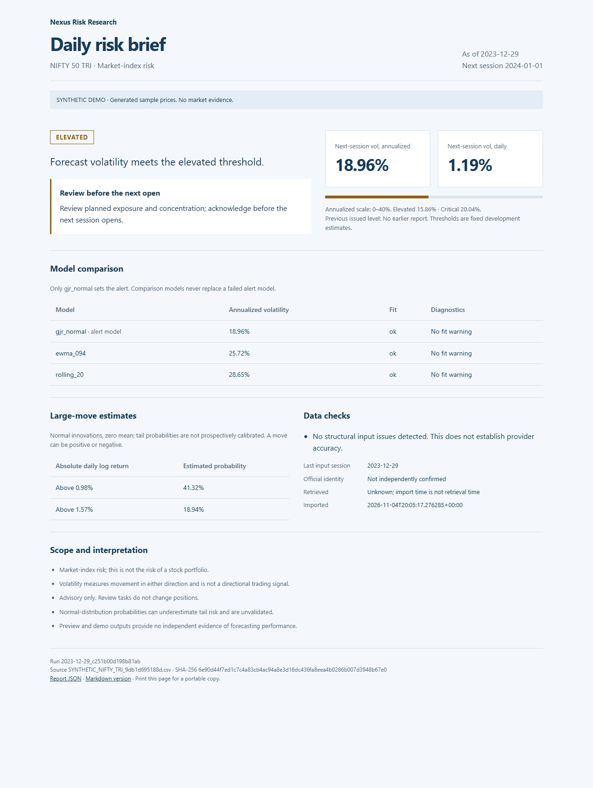

# Daily NIFTY risk brief

This first version turns an official NIFTY 50 gross total-return export into a saved HTML, Markdown and JSON brief. It uses the existing GJR-GARCH model for alerts, with EWMA and rolling-20 comparisons. It includes data checks, a review task, normal-distribution large-move estimates, and separate records for forecasts, alerts, acknowledgements, decisions and outcomes.

This is a **separate, narrower engineering MVP**, configured in `config/daily_monitoring.toml`. It does not amend or start the original 32-model H4 study. The original H4 CLI and frozen Stage 1–6 artifacts retain their original scope.

## Demo preview

This screenshot uses generated synthetic prices; it is not a live market forecast.



## Try the complete demo

From the repository root, with the dependencies in `pyproject.toml` installed:

```powershell
$env:PYTHONPATH = 'src'
.\.venv\Scripts\python.exe -m volrisk.daily_cli demo
```

Use your existing Python executable if you do not use `.venv`. The command prints the absolute HTML report path; open that file in a browser. JSON and Markdown exports sit beside it. The report can be printed without an internet connection. No new dependencies are required.

The demo generates deterministic **synthetic** prices inside `outputs/daily_risk/demo_inputs/`. It never writes synthetic observations into research datasets. Each code/configuration version gets a separate demo ledger under `outputs/daily_risk/demo_versions/`. Running the same version again reuses its issued report.

## Historical preview with your own data

```powershell
$env:PYTHONPATH = 'src'
.\.venv\Scripts\python.exe -m volrisk.daily_cli report `
  --source C:\research\nifty_tri_through_2023-12-29.csv `
  --as-of 2023-12-29 `
  --source-confirmed
```

Accepted inputs are the repository's existing official NIFTY TRI CSV or JSON formats. The CSV must contain a date and an explicit gross `Total Returns Index` column. An `Index Name` column containing `NIFTY 50` is recommended. For example:

```csv
Date,Index Name,Total Returns Index
2023-12-28,NIFTY 50,32500.12
2023-12-29,NIFTY 50,32480.34
```

Those two illustrative rows explain the format only; forecasting needs **at least 501 prices yielding 500 contiguous returns**. Include enough earlier history for the configured 1,000-session GJR window when available. Exports may be descending; they are sorted after validation. Dates after the report date, duplicates, nonpositive prices, unknown calendar coverage and wrong index identities are rejected. Source bytes are preserved.

`--source-confirmed` records your verification that the export is official NIFTY 50 gross TRI; it is not automated provider authentication. `--retrieved-at 2023-12-29T17:00:00+05:30` is optional and must represent the actual retrieval time. Unknown retrieval time stays unknown; import time is recorded separately. This version **imports supplied exports; it does not scrape NSE or substitute NIFTY spot prices**. An official/licensed feed can deliver the same exports to this command later.

Preview is limited to dates through 2024-12-31. It is a software check, not independent forecast evidence. The supplied export must stop at the origin session. No 2025–2026 holdout outcomes are evaluated.

## Report behavior

- NORMAL, ELEVATED and CRITICAL are risk levels. DATA_STALE, DATA_UNAVAILABLE and MODEL_FAILURE never appear as NORMAL.
- Only GJR sets the level. A failed or nonconverged GJR fit is not replaced with EWMA. Fit warnings remain visible.
- Forecasts use the existing walk-forward engine and recorded model settings; missing returns break history instead of compressing time.
- Alert thresholds come from the saved development table. They are not recalibrated using preview outcomes.
- Escalation is immediate. A step down requires three consecutive valid sessions below the current level. Missing, unissued or invalid sessions reset the counter but retain the last valid risk state. This is explicitly the new MVP policy; the earlier H4 helper's documented pause behavior is unchanged.
- Annualized volatility is `sqrt(252 * daily variance)`; it describes the next session in annualized units. It is not a one-year forecast. Large-move probabilities assume normal, zero-mean log returns and are explicitly unvalidated.
- Reports issue chronologically. A successfully issued session cannot be replaced. Failed attempts can be retried with corrected inputs; all attempts remain recorded. Exact reruns are idempotent.
- A process lock serializes issuance. If a process crashes, inspect the PID in `.issuance.lock` and ensure it has stopped before manually removing that lock. No automatic stale-lock deletion occurs.
- JSON uses `null` for unavailable measurements, not nonstandard `NaN` values. Report HTML escapes source and diagnostic text.

## Review notes and outcomes

Use the ledger beside the mode's `report.html` and the run ID printed by the CLI. For the default historical preview:

```powershell
python -m volrisk.daily_cli acknowledge --ledger outputs/daily_risk/preview/ledger.sqlite3 `
  --run-id RUN_ID --reviewer "Analyst name" --note "Exposure and concentration reviewed."

python -m volrisk.daily_cli decision --ledger outputs/daily_risk/preview/ledger.sqlite3 `
  --run-id RUN_ID --reviewer "Analyst name" --note "Review completed; rationale recorded here."

python -m volrisk.daily_cli outcome --ledger outputs/daily_risk/preview/ledger.sqlite3 `
  --run-id RUN_ID --source C:\research\tri_including_target_session.csv

python -m volrisk.daily_cli verify --ledger outputs/daily_risk/preview/ledger.sqlite3
```

The outcome export must include the origin and target prices. The origin must exactly match the issuance vintage; revisions are rejected for explicit reconciliation. Outcomes are appended separately after the target closes in live mode. They never edit forecasts or alerts. Outcome source bytes are also retained. Preview outcomes are not formal evaluation evidence.

SQLite transactions write forecast and alert together. Unique event keys reject conflicting duplicates. Every row has a sequence, recording time, previous hash and record hash. Hashes detect edits; they do not authenticate reviewers or protect against an administrator replacing the entire database. Back up the ledger and snapshots together. All five event types share one transactional table and can be read separately by `kind`; they are not five independent databases.

## Before live operation

The included configuration is DRAFT. No live registration has been made. Live mode is implemented but requires a separately reviewed configuration and registration; changing the old H4 status does not activate this MVP.

1. Agree the MVP model, development thresholds, normal-probability assumptions, review responsibilities and step-down policy. The report makes no portfolio-risk or trading-performance claim.
2. Supply official TRI exports and a reviewed calendar covering the historical inputs, origin and next session. The repository's current calendar ends on **2026-11-02**. Do not extend coverage by guessing future business days. Special-session live issuance remains unavailable until independently verified session times are supported.
3. Copy the configuration, retaining its location under a `config/` directory (or use absolute input paths). Set the reviewed copy to FROZEN; preserve the earlier research files.
4. Register that exact configuration and environment:

```powershell
python -m volrisk.daily_cli register --config config/daily_reviewed.toml `
  --approved-by "Actual reviewer" --output outputs/daily_registration.json
```

5. Issue after a completed regular session, before the next regular session opens:

```powershell
python -m volrisk.daily_cli report --mode live --config config/daily_reviewed.toml `
  --registration outputs/daily_registration.json --source C:\research\latest_tri.csv `
  --as-of YYYY-MM-DD --source-confirmed --retrieved-at ACTUAL_ISO_TIMESTAMP
```

The origin must begin after registration. Registration binds code, all configured input artifacts, configuration, Python and numerical package versions. A mismatch, future retrieval timestamp, pre-close invocation or late issuance is rejected. The reviewer field is a self-attestation, not an access-control mechanism.

Exit code 0 means a valid report (or successful ledger operation), 1 means a saved operational-failure report, and 2 means configuration, integrity, timing or command failure. A scheduler can use these statuses; this change does not create a scheduled task, connect a broker, or send notifications.

## Monitoring corrections and evaluation limits

- Brier score and its reference now use the same finite probability/outcome pairs. Invalid probability ranges and nonbinary events fail explicitly.
- Alert arrays must align; mismatched operational-status lengths cannot silently discard sessions.
- Mincer–Zarnowitz diagnostics now include approximate pointwise HAC intervals, preserving missing-session spacing. This does not turn a short sample into independent confirmation.
- The earlier H4 document's criterion “observed frequencies fall within their Wilson intervals” is not a calibration test. That archived document is preserved. A successor evaluation must compare predicted probabilities with observed frequencies, using a preregistered method that accounts for serial dependence and multiple comparisons. Merely lying inside a wide interval is not proof of calibration.

The original 252-session H4 study is **not executed by this tool**. The CLI records outcomes for later evaluation but does not automatically declare a research success, retrain models based on results or amend any protocol.

## Verification

```powershell
$env:PYTEST_DISABLE_PLUGIN_AUTOLOAD = '1'
python -m pytest -q tests/test_daily_monitoring.py tests/test_h4_monitoring.py `
  tests/test_walk_forward.py tests/test_forecasting_models.py
```

Tests exercise issuance ordering, idempotency, conflicts, stale/missing/invalid inputs, no substitution, state across gaps, live timing and registration checks, separate review/outcome records, HTML escaping, ledger integrity and the evaluation regressions. Fixtures are synthetic and stay in temporary directories.
