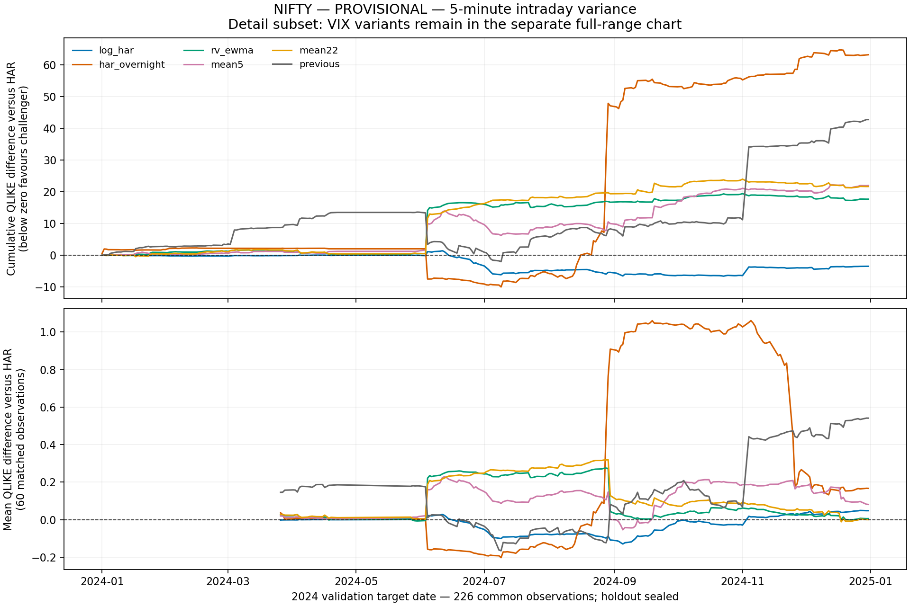

# Stage 4 empirical readout — PROVISIONAL

Completed run `d3094f857ec08cfaad204970`. These are **2024 validation findings**, not holdout findings. NIFTY is user-confirmed NSE spot. The export vendor chain, original timezone and bar-label conventions are still unverified. The extra full-session VIX lag reduces timing risk but does not verify provenance. The existing intraday pipeline and raw files were not modified or rerun.

## Sample and eligibility

| asset | period | session_rows | complete_sessions | all_har_origin_features | excluded_sessions |
| --- | --- | --- | --- | --- | --- |
| NIFTY | development | 293 | 288 | 205 | 5 |
| NIFTY | validation | 249 | 248 | 227 | 1 |
| SENSEX | development | 246 | 126 | 70 | 120 |
| SENSEX | validation | 250 | 239 | 123 | 11 |

The primary NIFTY comparison has **226 matched target dates**; SENSEX has only **61**. Of 249 NIFTY validation origins, 22 could not produce HAR predictions because the complete causal feature set was missing, and 1 additional target was unavailable. Missing sessions break the 22-session feature window; they are not skipped or imputed. Successful OLS estimation therefore does not imply that every session has a usable prediction.

Gates independently reconcile within-session bar returns with RV, require valid session completeness, check adjacent endpoints for overnight returns, validate origin/target chronology, and require VIX availability before the origin. HAR variants share training rows as well as evaluation dates. Complete verified short special sessions remain at their actual duration. All exclusions are retained in `har_rv_exclusions.csv`.

## NIFTY: primary 5-minute intraday variance target

| QLIKE rank | Model | QLIKE | Observed / forecast | Calibration rank | Floored predictions |
| --- | --- | --- | --- | --- | --- |
| 1 | log_har | -8.93276 | 1.1579 | 9 | 0 |
| 2 | har | -8.91741 | 1.02901 | 4 | 0 |
| 3 | rv_ewma | -8.83928 | 1.03667 | 5 | 0 |
| 4 | mean22 | -8.8216 | 1.01832 | 3 | 0 |
| 5 | mean5 | -8.82022 | 1.01091 | 2 | 0 |
| 6 | previous | -8.72841 | 1.00266 | 1 | 0 |
| 7 | har_overnight | -8.63803 | 1.05902 | 6 | 0 |
| 8 | har_vix_overnight | 11295.1 | 1.06991 | 7 | 1 |
| 9 | har_vix | 125284 | 1.14688 | 8 | 21 |

Calibration is mean observed variance divided by mean forecast variance; one is ideal. Calibration rank uses absolute log distance from one, separately from QLIKE. The lowest mean QLIKE is **log_har**, but that is a point-estimate ranking, not an established winner. A better QLIKE need not imply better average calibration.

Mean QLIKE difference (log_har minus har) = **-0.015346**; pointwise bootstrap 95% interval **[-0.070982, 0.030304]**. HAC/Holm p = 1; bootstrap/Holm p = 1.

Log-HAR has lower QLIKE than HAR in 3 of 4 validation quarters. Across the entire predeclared family of 284 comparisons, 0 pass both global Holm-adjusted HAC and block-bootstrap checks. The bootstrap uses 10,000 draws and gap-aware blocks. Pointwise intervals are not simultaneous intervals. The broad family and short sample reduce power; nonsignificance does not establish equivalence.

## India VIX: tested specification fails positivity

Levels HAR+VIX generated **21 negative raw predictions** on the primary matched sample; HAR+VIX+overnight generated **1**. The predefined training-only floor retained those forecasts as tiny positive values, which caused very large QLIKE losses. Floored values are flagged separately from missing forecasts and fit failures. The fitted coefficients were not changed to improve these results. A negative prediction was independently reconciled against its saved coefficients.

HAR+VIX floor events span 2024-06-07 through 2024-07-26. Inspect `har_rv_floor_events.csv` for dates, raw predictions, final variances and training windows.

The evidence does **not** demonstrate useful incremental VIX performance for the tested levels specification. It does not show that VIX contains no predictive information. The annualized implied-variance feature is (lagged VIX percent / 100)^2; it is not treated as a directly observed next-day variance. Its approximately 30-calendar-day horizon differs from the target.

## Overnight features and separate daily-return benchmarks

For the intraday-plus-overnight target, har_overnight has the lowest point-estimate QLIKE (-8.557679) and calibration 1.155384. This proxy is RV plus the observed overnight square; it is not squared daily close-to-close return.

Mean QLIKE difference (har_overnight minus har) = **-0.046930**; pointwise bootstrap 95% interval **[-0.132982, 0.048610]**. HAC/Holm p = 1; bootstrap/Holm p = 1.

Excluding retrospectively labelled shock dates changes the overnight model's paired difference to **0.013763**. Its apparent gain is therefore sensitive to event composition. Overnight features worsen the primary intraday point estimate. A shock-period improvement does not establish a generally superior model.

In the separate same-spot-series close-to-close proxy panel (227 dates), spot_garch ranks first by QLIKE (-8.461271); calibration is 1.496337. This ranking cannot be transferred to the intraday target. SENSEX has 0 common dates for the daily-GARCH panel because missing sessions prevent the required contiguous return history. No artificial forecasts were added.

## Sampling frequency, events and sensitivity

| target | frequency | model | n_same_dates_across_frequencies | qlike |
| --- | --- | --- | --- | --- |
| intraday | 1 | log_har | 226 | -8.98037 |
| intraday | 5 | log_har | 226 | -8.93276 |
| intraday | 10 | log_har | 226 | -8.95484 |
| intraday | 15 | log_har | 226 | -8.8102 |
| intraday_overnight | 1 | log_har | 226 | -8.58796 |
| intraday_overnight | 5 | har_overnight | 226 | -8.55768 |
| intraday_overnight | 10 | log_har | 226 | -8.55205 |
| intraday_overnight | 15 | log_har | 226 | -8.45656 |

Each frequency is a different target: compare model ranks within a frequency, not QLIKE levels between frequencies. Log-HAR's primary ranking persists across the four frequencies; the overnight-augmented model's secondary first-place ranking is not frequency-stable.

| model | n | calibration_ratio | underprediction_fraction |
| --- | --- | --- | --- |
| har | 6 | 10.6305 | 1 |
| har_vix | 6 | 7.69086 | 1 |
| log_har | 6 | 11.3055 | 1 |
| rv_ewma | 6 | 10.9531 | 1 |

These shock labels are retrospective and never enter estimation. The small event count cannot establish which model adapts fastest. The tested models materially underpredict these shocks. Large VIX-model losses during recovery also reflect invalid negative raw predictions, not merely slow mean reversion.

The additional absolute-return/stale-price exclusion rule flags 0 sessions in the pre-holdout panels. The maximum absolute paired QLIKE change from that exclusion scenario is 0. Identical results are not independent evidence of robustness to unverified provenance. Full-file MAD flags are not used in causal model selection or exclusions because their thresholds incorporate later data.

SENSEX's 61-date matched sample is too short to support reliable cross-market generalization. No NIFTY-based implied-volatility feature is silently assigned to SENSEX.

## Next experiment and remaining limits

Retain HAR, log-HAR and RV-EWMA as comparison candidates. After confirming source/export timing, pre-register a positive-link or log-HAR+VIX extension and an explicit forecast-floor sensitivity plan. Do not repair the current ranking by choosing floors after observing losses. Overnight features remain a target-specific candidate, with uncertain event-driven gains. A genuinely unseen sample is needed: this Stage 4 run never reads numerical targets after 2024, but earlier project work already exposed aspects of 2025–2026, so those historical dates cannot be described as pristine at the project level. No portfolio utility has been tested.

Numerical, temporal, issuance-order and hash checks are recorded in `har_rv_verification.json`. The full suite passed 259 tests. The real run emitted a nonfatal pandas FutureWarning for concatenating all-NA date columns in the unavailable SENSEX daily benchmark panel; the current outputs passed verification. Future pandas compatibility should be checked before upgrading dependencies.

## Readable forecast-loss detail

The additional chart below displays the non-VIX subset relative to HAR on the same matched dates. The original all-model `NIFTY_qlike.png` retains the full VIX loss scale; no losses or model rows were removed.

Reproduce this readout after the main experiment with `.\.venv\Scripts\python.exe scripts/summarize_har_results.py`. The supplementary readout has its own hash manifest and does not modify immutable experiment outputs.
