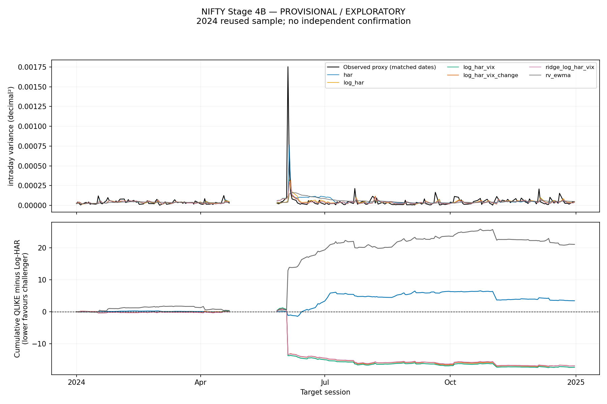
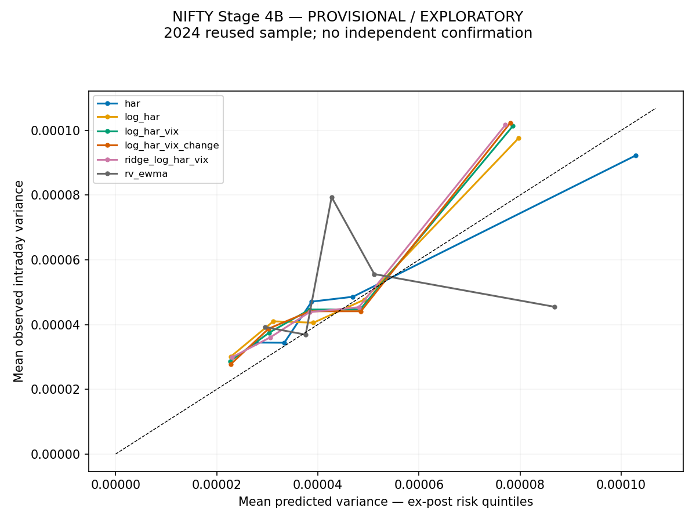
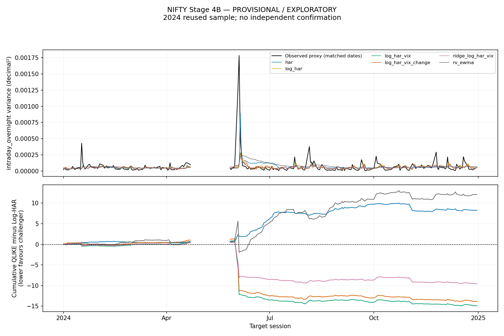
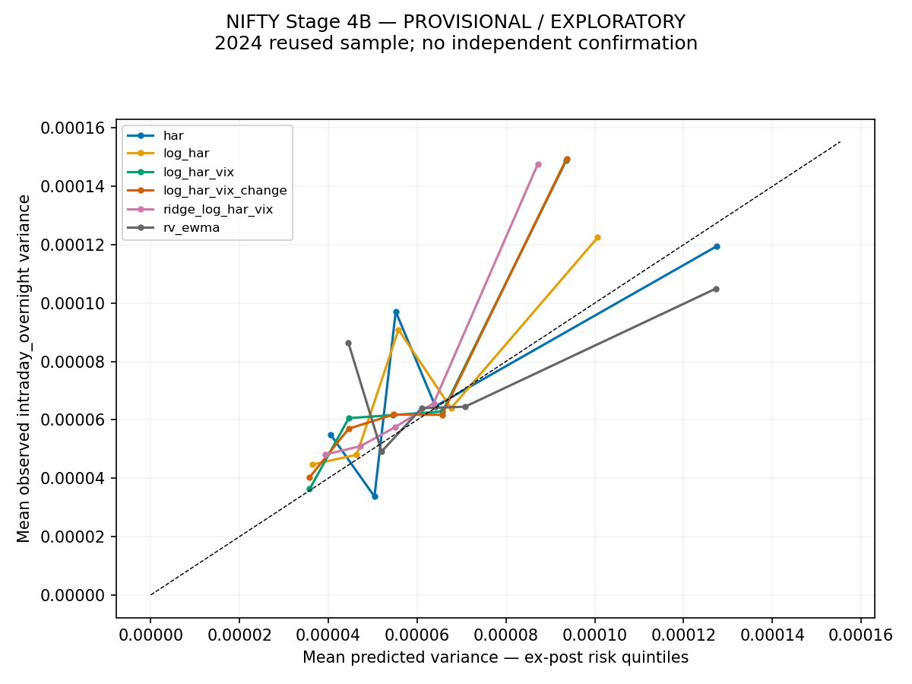
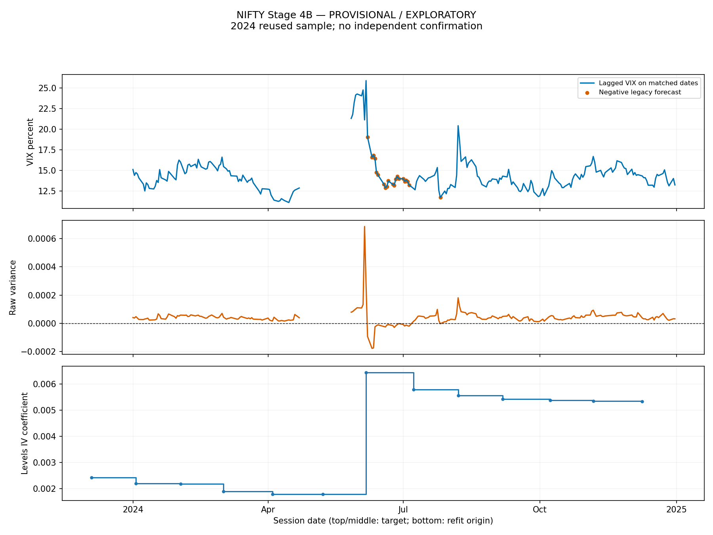
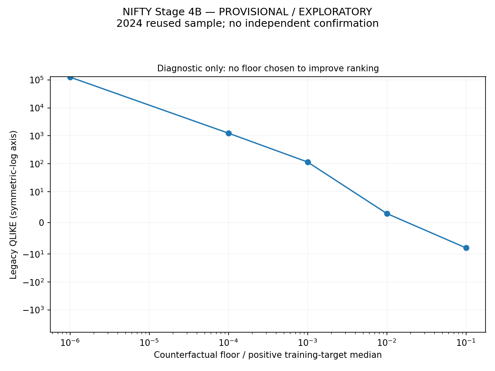

# Positive VIX models — exploratory 2024 results

**PROVISIONAL / EXPLORATORY.** Model specifications were motivated by the already inspected 2024 results. Every 2024 improvement, interval and p-value below is exploratory, not independent confirmation. Only saved Stage 4 panels through 2024-12-31 were read numerically; no 2025–2026 data was loaded. NIFTY is user-confirmed NSE spot; vendor/export, original timezone and bar labels remain unverified.

## Empirical interpretation — exploratory only

log_har_vix has the lowest primary QLIKE. M1 minus M0 is -0.076779, with pointwise bootstrap interval [-0.160144, 0.000130]. None of the claims should be treated as independent confirmation; 0 of 10 contrasts pass both multiplicity-adjusted checks in this run.

M1 improves the point-estimate QLIKE in 4 of four quarters, but the magnitude is uneven. High-IV origins (n=80) have mean M1−M0 difference -0.199530; other-IV origins have -0.009518. After removing the retrospectively labelled shock dates, the difference is -0.009078. The five largest absolute daily loss differences contribute 51.0% of absolute paired differences. VIX has promising conditional information in this sample, but much of the apparent gain comes from a few high-risk events.

Adding the change feature gives M2−M1 difference 0.001871 (negative would favour the extra feature). It does not improve the aggregate point estimate in this run. Ridge smooths some coefficient and prediction movements but does not beat unregularized M1 by mean QLIKE.

Primary calibration is 1.176758 for M1, 1.157899 for M0, and 1.029008 for standard HAR. The archived levels HAR+VIX ratio is 1.146880. Positivity fixes the invalid-forecast mechanism, but does not improve average calibration: M1 still underpredicts aggregate variance. An apparently reasonable average calibration can conceal catastrophic individual floor losses.

Recommended research candidates: keep M0 and standard HAR/RV-EWMA as references, and M1 as the simplest promising VIX challenger. Keep M3 as a prespecified stability comparator; M2 has no demonstrated incremental benefit here. No model is certified as a replacement. All six remain in the frozen prospective comparison set to avoid silently dropping unsuccessful variants.

## Forecast availability, separate from positivity

| target | model | origins | valid_predictions | common_evaluation_dates | missing_origin_features | warmup_or_gap_reset | other_prediction_failures | unavailable_targets |
| --- | --- | --- | --- | --- | --- | --- | --- | --- |
| intraday | har | 249 | 227 | 226 | 22 | 0 | 0 | 1 |
| intraday | log_har | 249 | 227 | 226 | 22 | 0 | 0 | 1 |
| intraday | log_har_vix | 249 | 227 | 226 | 22 | 0 | 0 | 1 |
| intraday | log_har_vix_change | 249 | 227 | 226 | 22 | 0 | 0 | 1 |
| intraday | ridge_log_har_vix | 249 | 227 | 226 | 22 | 0 | 0 | 1 |
| intraday | rv_ewma | 249 | 227 | 226 | 0 | 22 | 0 | 1 |
| intraday_overnight | har | 249 | 227 | 226 | 22 | 0 | 0 | 1 |
| intraday_overnight | log_har | 249 | 227 | 226 | 22 | 0 | 0 | 1 |
| intraday_overnight | log_har_vix | 249 | 227 | 226 | 22 | 0 | 0 | 1 |
| intraday_overnight | log_har_vix_change | 249 | 227 | 226 | 22 | 0 | 0 | 1 |
| intraday_overnight | ridge_log_har_vix | 249 | 227 | 226 | 22 | 0 | 0 | 1 |
| intraday_overnight | rv_ewma | 249 | 227 | 226 | 0 | 22 | 0 | 1 |

Missing origin features and benchmark gap resets are data-availability losses, not optimizer failures. They remain in the all-attempt failure denominator. A positive-link forecast can be valid when its next target later proves unavailable; it is then retained but not scored. No synthetic forecast fills a gap.

## Frozen specifications and estimation

M0 Log-HAR: log RV, log arithmetic 5-session RV average, log arithmetic 22-session RV average. M1 adds log annualized IV. M2 adds one signed change in log IV. M3 uses M1 features with Ridge. Standard HAR and RV-EWMA remain benchmarks. All regressions use a 500-session-position window, 126 completed pairs minimum and 21-session refits. Gaps are preserved. The original refit schedule is replayed for initialization; only 2024 forecasts are issued for the final six-model experiment.

The additional full-session VIX lag is retained. Changes require two adjacent available lagged IV values; missing values are not filled or differenced across gaps. India VIX is annualized implied volatility over approximately 30 calendar days. Log IV is a regressor with an estimated coefficient, not a one-day variance observation.

All five regressions use the same completed training pairs, including the original overnight-availability restriction and an additional VIX-change-availability mask. The mask is not a regressor. RV-EWMA smooths observed target variance with lambda .94 and a 22-observation initialization; matching its estimation observations to supervised regression pairs would change the benchmark. Evaluation dates are identical.

Actual sample differences from Stage 4 are shown below. Numerical roundoff can change Log-HAR predictions at machine precision because retransformation uses logsumexp; changed samples, if any, are counted explicitly.

| target | stage4_common_dates | stage4b_common_dates | shared_dates | lost_dates | gained_dates | identical_training_refits | changed_training_refits | unpaired_refits | max_log_har_prediction_difference | minimum_regression_training_pairs | maximum_regression_training_pairs | status |
| --- | --- | --- | --- | --- | --- | --- | --- | --- | --- | --- | --- | --- |
| intraday | 226 | 226 | 226 | [] | [] | 19 | 0 | 0 | 4.87891e-19 | 126 | 410 | PROVISIONAL_EXPLORATORY |
| intraday_overnight | 226 | 226 | 226 | [] | [] | 19 | 0 | 0 | 3.79471e-19 | 126 | 410 | PROVISIONAL_EXPLORATORY |

Zero RV targets/features use 10^-6 times the positive training-target median only inside the log transformation. Positive small RV values are not clipped. Missing, negative or nonfinite RV and nonpositive IV are invalid. Observed outcomes are never replaced. Back-transformation is exp(predicted log variance + log training-residual smearing), computed stably with logsumexp. All log models use the same correction. This assumes a common residual distribution and is not a guarantee of conditional unbiasedness.

1816 issued usable log-model forecasts are strictly positive; 0 use a prediction floor. Overflow, underflow and nonfinite predictions are missing failures, never clipped. The configured annualized-volatility ceiling rejects explosive forecasts rather than replacing them. Standard levels HAR retains its existing flagged floor policy; it is not a new positive-link model.

## Development-only Ridge choice

| target | alpha | selection_available_on | tuning_cutoff | score | criterion | grid_size |
| --- | --- | --- | --- | --- | --- | --- |
| intraday | 10 | 2023-12-29 | 2023-12-31 | -9.80058 | equal_fold_mean_qlike_then_larger_alpha_on_exact_tie | 4 |
| intraday_overnight | 100 | 2023-12-29 | 2023-12-31 | -9.16702 | equal_fold_mean_qlike_then_larger_alpha_on_exact_tie | 4 |

| target | ridge_alpha | fold | fold_start | fold_end | n_common | qlike | unexpected_failures | first_target | last_target | selected |
| --- | --- | --- | --- | --- | --- | --- | --- | --- | --- | --- |
| intraday | 0.1 | 1 | 2023-09-01 00:00:00 | 2023-10-31 00:00:00 | 35 | -9.72198 | 0 | 2023-09-08 00:00:00 | 2023-10-31 00:00:00 | False |
| intraday | 0.1 | 2 | 2023-11-01 00:00:00 | 2023-12-31 00:00:00 | 41 | -9.87132 | 0 | 2023-11-01 00:00:00 | 2023-12-29 00:00:00 | False |
| intraday | 1 | 1 | 2023-09-01 00:00:00 | 2023-10-31 00:00:00 | 35 | -9.72338 | 0 | 2023-09-08 00:00:00 | 2023-10-31 00:00:00 | False |
| intraday | 1 | 2 | 2023-11-01 00:00:00 | 2023-12-31 00:00:00 | 41 | -9.87104 | 0 | 2023-11-01 00:00:00 | 2023-12-29 00:00:00 | False |
| intraday | 10 | 1 | 2023-09-01 00:00:00 | 2023-10-31 00:00:00 | 35 | -9.73263 | 0 | 2023-09-08 00:00:00 | 2023-10-31 00:00:00 | True |
| intraday | 10 | 2 | 2023-11-01 00:00:00 | 2023-12-31 00:00:00 | 41 | -9.86852 | 0 | 2023-11-01 00:00:00 | 2023-12-29 00:00:00 | True |
| intraday | 100 | 1 | 2023-09-01 00:00:00 | 2023-10-31 00:00:00 | 35 | -9.74808 | 0 | 2023-09-08 00:00:00 | 2023-10-31 00:00:00 | False |
| intraday | 100 | 2 | 2023-11-01 00:00:00 | 2023-12-31 00:00:00 | 41 | -9.85287 | 0 | 2023-11-01 00:00:00 | 2023-12-29 00:00:00 | False |
| intraday_overnight | 0.1 | 1 | 2023-09-01 00:00:00 | 2023-10-31 00:00:00 | 35 | -9.20466 | 0 | 2023-09-08 00:00:00 | 2023-10-31 00:00:00 | False |
| intraday_overnight | 0.1 | 2 | 2023-11-01 00:00:00 | 2023-12-31 00:00:00 | 41 | -9.05755 | 0 | 2023-11-01 00:00:00 | 2023-12-29 00:00:00 | False |
| intraday_overnight | 1 | 1 | 2023-09-01 00:00:00 | 2023-10-31 00:00:00 | 35 | -9.20676 | 0 | 2023-09-08 00:00:00 | 2023-10-31 00:00:00 | False |
| intraday_overnight | 1 | 2 | 2023-11-01 00:00:00 | 2023-12-31 00:00:00 | 41 | -9.05754 | 0 | 2023-11-01 00:00:00 | 2023-12-29 00:00:00 | False |
| intraday_overnight | 10 | 1 | 2023-09-01 00:00:00 | 2023-10-31 00:00:00 | 35 | -9.2218 | 0 | 2023-09-08 00:00:00 | 2023-10-31 00:00:00 | False |
| intraday_overnight | 10 | 2 | 2023-11-01 00:00:00 | 2023-12-31 00:00:00 | 41 | -9.0578 | 0 | 2023-11-01 00:00:00 | 2023-12-29 00:00:00 | False |
| intraday_overnight | 100 | 1 | 2023-09-01 00:00:00 | 2023-10-31 00:00:00 | 35 | -9.26308 | 0 | 2023-09-08 00:00:00 | 2023-10-31 00:00:00 | True |
| intraday_overnight | 100 | 2 | 2023-11-01 00:00:00 | 2023-12-31 00:00:00 | 41 | -9.07095 | 0 | 2023-11-01 00:00:00 | 2023-12-29 00:00:00 | True |

Each grid strength is evaluated chronologically in fixed September–October and November–December 2023 blocks. Scaling, coefficients, zero-RV transformation and smearing are refitted using only observations available at each origin. Selection minimizes the equally weighted fold mean QLIKE, requires at least 30 common observations per fold and no unexpected forecast failures, and chooses larger alpha only on an exact tie. Alpha is frozen before the first 2024 origin. Initial historical coefficient-state replay is not published as a forecast made before configuration selection. Ridge penalizes standardized slopes, not the intercept; its penalty convention is SSE + alpha times squared slope norm.

A coverage-only protocol amendment preceded all new 2024 results: the original Q3/Q4 2023 split yielded only 15/61 usable observations and failed the fixed 30-per-fold gate. The preserved aborted registration is b5441dbe33562a1781aae56f. The revised blocks provide 35/41 observations on the actual sample. The same four Ridge strengths were used; no development loss values were inspected to choose new boundaries. Two fold designs were considered and four primary-target grid runs were aborted before the final eight target/alpha grid runs. These are repeated configurations, not four additional distinct models. Only 76 development evaluation dates support tuning, so the choice of penalty is uncertain and must not be described as a robust optimum.

## Primary target: 5-minute intraday RV

| rank_qlike | model | n_evaluated | qlike | mse | mae | calibration_ratio | rank_calibration | bias | forecast_stability | estimation_failure_rate | prediction_failure_rate | runtime_seconds |
| --- | --- | --- | --- | --- | --- | --- | --- | --- | --- | --- | --- | --- |
| 1 | log_har_vix | 226 | -9.00953 | 1.29812e-08 | 3.0616e-05 | 1.17676 | 4 | -7.7027e-06 | 0.266622 | 0 | 0.0883534 | 0.378187 |
| 2 | log_har_vix_change | 226 | -9.00766 | 1.318e-08 | 3.09704e-05 | 1.1787 | 5 | -7.77465e-06 | 0.266348 | 0 | 0.0883534 | 0.351707 |
| 3 | ridge_log_har_vix | 226 | -9.00763 | 1.30834e-08 | 3.06529e-05 | 1.18289 | 6 | -7.9286e-06 | 0.255072 | 0 | 0.0883534 | 0.34665 |
| 4 | log_har | 226 | -8.93276 | 1.39728e-08 | 3.19171e-05 | 1.1579 | 3 | -6.99294e-06 | 0.307235 | 0 | 0.0883534 | 0.379104 |
| 5 | har | 226 | -8.91741 | 1.46439e-08 | 3.61889e-05 | 1.02901 | 1 | -1.4456e-06 | 0.226816 | 0 | 0.0883534 | 0.367767 |
| 6 | rv_ewma | 226 | -8.83928 | 1.5068e-08 | 3.80402e-05 | 1.03667 | 2 | -1.81415e-06 | 0.0419827 | 0 | 0 | 0.365087 |

## Secondary target: intraday RV + overnight square

| rank_qlike | model | n_evaluated | qlike | mse | mae | calibration_ratio | rank_calibration | bias | forecast_stability | estimation_failure_rate | prediction_failure_rate | runtime_seconds |
| --- | --- | --- | --- | --- | --- | --- | --- | --- | --- | --- | --- | --- |
| 1 | log_har_vix | 226 | -8.61323 | 2.16406e-08 | 4.54456e-05 | 1.25801 | 5 | -1.51552e-05 | 0.233361 | 0 | 0.0883534 | 0.352588 |
| 2 | log_har_vix_change | 226 | -8.60857 | 2.17218e-08 | 4.56144e-05 | 1.25784 | 4 | -1.51473e-05 | 0.233751 | 0 | 0.0883534 | 0.343158 |
| 3 | ridge_log_har_vix | 226 | -8.58956 | 2.22056e-08 | 4.63361e-05 | 1.26495 | 6 | -1.54775e-05 | 0.17034 | 0 | 0.0883534 | 0.382311 |
| 4 | log_har | 226 | -8.54731 | 2.25997e-08 | 4.72576e-05 | 1.20621 | 3 | -1.2633e-05 | 0.26597 | 0 | 0.0883534 | 0.34185 |
| 5 | har | 226 | -8.51075 | 2.36474e-08 | 5.22501e-05 | 1.09644 | 2 | -6.49958e-06 | 0.182684 | 0 | 0.0883534 | 0.36074 |
| 6 | rv_ewma | 226 | -8.4938 | 2.35168e-08 | 5.65077e-05 | 1.04067 | 1 | -2.88808e-06 | 0.0429511 | 0 | 0 | 0.171572 |

Targets are distinct; their QLIKE levels must not be pooled or ranked across targets. Calibration is mean observed / mean predicted variance; ideal is one. A good QLIKE does not guarantee good aggregate calibration. Forecast distributions, positivity counts and failures appear in stage4b_comparison.csv.

## Original unsuccessful levels comparator — archived predictions, no new ranking

| target | model | n_evaluated | qlike | calibration_ratio | prediction_floor_count |
| --- | --- | --- | --- | --- | --- |
| intraday | legacy_levels_har_vix | 226 | 125284 | 1.14688 | 21 |
| intraday_overnight | legacy_levels_har_vix | 226 | 118806 | 1.21064 | 21 |

The legacy predictions are copied unchanged from Stage 4. They do not determine the six-model common-date sample, and they receive no new rank. Their own training rows may differ if the new change-availability mask excludes observations. The legacy event file retains every original matched event.

## Paired uncertainty and research-selection limits

| target | challenger | reference | n | mean_loss_difference | ci_low | ci_high | hac_p_holm | bootstrap_p_holm | passes_exploratory_adjustment | top5_share_absolute_loss_difference |
| --- | --- | --- | --- | --- | --- | --- | --- | --- | --- | --- |
| intraday | log_har_vix | log_har | 226 | -0.0767785 | -0.160144 | 0.000130135 | 1 | 0.423158 | False | 0.509548 |
| intraday | log_har_vix_change | log_har | 226 | -0.0749075 | -0.155842 | -0.000491415 | 1 | 0.423158 | False | 0.499385 |
| intraday | ridge_log_har_vix | log_har | 226 | -0.0748792 | -0.1544 | -0.00124298 | 1 | 0.423158 | False | 0.513294 |
| intraday | log_har_vix | rv_ewma | 226 | -0.17025 | -0.362736 | 0.0101317 | 1 | 0.434957 | False | 0.437848 |
| intraday | log_har_vix_change | log_har_vix | 226 | 0.001871 | -0.0034336 | 0.00683475 | 1 | 0.60374 | False | 0.336098 |
| intraday_overnight | log_har_vix | log_har | 226 | -0.0659185 | -0.136756 | 0.00444685 | 1 | 0.447955 | False | 0.537537 |
| intraday_overnight | log_har_vix_change | log_har | 226 | -0.0612583 | -0.130204 | 0.00633386 | 1 | 0.457754 | False | 0.518363 |
| intraday_overnight | ridge_log_har_vix | log_har | 226 | -0.0422468 | -0.0904502 | 0.00696863 | 1 | 0.457754 | False | 0.483399 |
| intraday_overnight | log_har_vix | rv_ewma | 226 | -0.11943 | -0.218091 | -0.015758 | 0.267569 | 0.166983 | False | 0.312917 |
| intraday_overnight | log_har_vix_change | log_har_vix | 226 | 0.00466016 | 0.000225079 | 0.00812805 | 0.81878 | 0.179082 | False | 0.475892 |

The workflow tried 18 distinct model/target configurations: 8 Ridge grid candidates plus five fixed specifications per target. It produced 12 final cells, tested 10 predefined loss contrasts and inspected 5 legacy floor counterfactuals. There are no additional inferential quarter/regime tests. The original Stage 4 search and 2024-driven specification selection are additional research exposure; current Holm adjustment cannot undo that selection.

HAC uses native session positions; stationary bootstrap blocks restart across gaps. Bootstrap uses 10,000 draws, expected block length 10 and the recorded seed. Intervals are pointwise approximate 95% intervals. Holm covers all five contrasts on both targets jointly (10 comparisons), separately for HAC and bootstrap; the reported adjustment flag requires both. Even a passing flag is exploratory.

The interval is a percentile-style bootstrap summary, whereas the bootstrap p-value uses an absolute centered statistic. Under skewness these need not invert exactly; report both rather than inferring significance from an interval alone.

## VIX increments, quarters and event concentration

| target | challenger | reference | slice | n | mean_loss_difference | status | inferential_test |
| --- | --- | --- | --- | --- | --- | --- | --- |
| intraday | log_har_vix | log_har | origin_high_iv | 80 | -0.19953 | PROVISIONAL_EXPLORATORY | False |
| intraday | log_har_vix | log_har | origin_other_iv | 146 | -0.00951756 | PROVISIONAL_EXPLORATORY | False |
| intraday | log_har_vix | log_har | origin_rapid_iv_change | 30 | -0.0203874 | PROVISIONAL_EXPLORATORY | False |
| intraday | log_har_vix | log_har | without_retrospective_shocks | 220 | -0.00907841 | PROVISIONAL_EXPLORATORY | False |
| intraday | log_har_vix | log_har | 2024_Q1 | 62 | -0.00068023 | PROVISIONAL_EXPLORATORY | False |
| intraday | log_har_vix | log_har | 2024_Q2 | 38 | -0.389489 | PROVISIONAL_EXPLORATORY | False |
| intraday | log_har_vix | log_har | 2024_Q3 | 64 | -0.032455 | PROVISIONAL_EXPLORATORY | False |
| intraday | log_har_vix | log_har | 2024_Q4 | 62 | -0.00696884 | PROVISIONAL_EXPLORATORY | False |
| intraday | log_har_vix_change | log_har | origin_high_iv | 80 | -0.191599 | PROVISIONAL_EXPLORATORY | False |
| intraday | log_har_vix_change | log_har | origin_other_iv | 146 | -0.0109668 | PROVISIONAL_EXPLORATORY | False |
| intraday | log_har_vix_change | log_har | origin_rapid_iv_change | 30 | -0.0265938 | PROVISIONAL_EXPLORATORY | False |
| intraday | log_har_vix_change | log_har | without_retrospective_shocks | 220 | -0.0102181 | PROVISIONAL_EXPLORATORY | False |
| intraday | log_har_vix_change | log_har | 2024_Q1 | 62 | -0.000911594 | PROVISIONAL_EXPLORATORY | False |
| intraday | log_har_vix_change | log_har | 2024_Q2 | 38 | -0.376632 | PROVISIONAL_EXPLORATORY | False |
| intraday | log_har_vix_change | log_har | 2024_Q3 | 64 | -0.0347447 | PROVISIONAL_EXPLORATORY | False |
| intraday | log_har_vix_change | log_har | 2024_Q4 | 62 | -0.00543413 | PROVISIONAL_EXPLORATORY | False |
| intraday | ridge_log_har_vix | log_har | origin_high_iv | 80 | -0.19325 | PROVISIONAL_EXPLORATORY | False |
| intraday | ridge_log_har_vix | log_har | origin_other_iv | 146 | -0.0100187 | PROVISIONAL_EXPLORATORY | False |
| intraday | ridge_log_har_vix | log_har | origin_rapid_iv_change | 30 | -0.0191818 | PROVISIONAL_EXPLORATORY | False |
| intraday | ridge_log_har_vix | log_har | without_retrospective_shocks | 220 | -0.0109635 | PROVISIONAL_EXPLORATORY | False |
| intraday | ridge_log_har_vix | log_har | 2024_Q1 | 62 | -0.0025717 | PROVISIONAL_EXPLORATORY | False |
| intraday | ridge_log_har_vix | log_har | 2024_Q2 | 38 | -0.372744 | PROVISIONAL_EXPLORATORY | False |
| intraday | ridge_log_har_vix | log_har | 2024_Q3 | 64 | -0.0314617 | PROVISIONAL_EXPLORATORY | False |
| intraday | ridge_log_har_vix | log_har | 2024_Q4 | 62 | -0.00944229 | PROVISIONAL_EXPLORATORY | False |
| intraday | log_har_vix | rv_ewma | origin_high_iv | 80 | -0.317453 | PROVISIONAL_EXPLORATORY | False |
| intraday | log_har_vix | rv_ewma | origin_other_iv | 146 | -0.0895908 | PROVISIONAL_EXPLORATORY | False |
| intraday | log_har_vix | rv_ewma | origin_rapid_iv_change | 30 | -0.10639 | PROVISIONAL_EXPLORATORY | False |
| intraday | log_har_vix | rv_ewma | without_retrospective_shocks | 220 | -0.0567057 | PROVISIONAL_EXPLORATORY | False |
| intraday | log_har_vix | rv_ewma | 2024_Q1 | 62 | -0.0235785 | PROVISIONAL_EXPLORATORY | False |
| intraday | log_har_vix | rv_ewma | 2024_Q2 | 38 | -0.85128 | PROVISIONAL_EXPLORATORY | False |
| intraday | log_har_vix | rv_ewma | 2024_Q3 | 64 | -0.106634 | PROVISIONAL_EXPLORATORY | False |
| intraday | log_har_vix | rv_ewma | 2024_Q4 | 62 | 0.0348162 | PROVISIONAL_EXPLORATORY | False |
| intraday | log_har_vix_change | log_har_vix | origin_high_iv | 80 | 0.00793037 | PROVISIONAL_EXPLORATORY | False |
| intraday | log_har_vix_change | log_har_vix | origin_other_iv | 146 | -0.0014492 | PROVISIONAL_EXPLORATORY | False |
| intraday | log_har_vix_change | log_har_vix | origin_rapid_iv_change | 30 | -0.00620634 | PROVISIONAL_EXPLORATORY | False |
| intraday | log_har_vix_change | log_har_vix | without_retrospective_shocks | 220 | -0.00113969 | PROVISIONAL_EXPLORATORY | False |
| intraday | log_har_vix_change | log_har_vix | 2024_Q1 | 62 | -0.000231364 | PROVISIONAL_EXPLORATORY | False |
| intraday | log_har_vix_change | log_har_vix | 2024_Q2 | 38 | 0.0128574 | PROVISIONAL_EXPLORATORY | False |
| intraday | log_har_vix_change | log_har_vix | 2024_Q3 | 64 | -0.0022897 | PROVISIONAL_EXPLORATORY | False |
| intraday | log_har_vix_change | log_har_vix | 2024_Q4 | 62 | 0.00153471 | PROVISIONAL_EXPLORATORY | False |

High-IV regimes use the 75th percentile of strictly earlier available lagged IV, with at least 60 prior observations. Rapid-change regimes likewise use past thresholds. These are origin-known classifications. Shock exclusions and event windows are retrospective diagnostics only; they never enter feature selection or a prospective decision rule. The top-five concentration is a share of absolute paired loss differences, not a signed gain share. M2 versus M1 directly tests the extra change feature.

## Coefficient and forecast stability

| asset | frequency | scenario | target | model | period | parameter | fits | mean | std | min | max | maximum_absolute_change | status |
| --- | --- | --- | --- | --- | --- | --- | --- | --- | --- | --- | --- | --- | --- |
| NIFTY | 5 | eligible | intraday | log_har_vix | validation | vix_implied_variance | 12 | 0.764424 | 0.0531633 | 0.702188 | 0.893257 | 0.0940144 | PROVISIONAL_EXPLORATORY |
| NIFTY | 5 | eligible | intraday | log_har_vix_change | validation | vix_implied_variance | 12 | 0.733462 | 0.0698477 | 0.657354 | 0.904357 | 0.132419 | PROVISIONAL_EXPLORATORY |
| NIFTY | 5 | eligible | intraday | ridge_log_har_vix | validation | vix_implied_variance | 12 | 0.72679 | 0.0420494 | 0.671183 | 0.819905 | 0.0838421 | PROVISIONAL_EXPLORATORY |
| NIFTY | 5 | eligible | intraday_overnight | log_har_vix | validation | vix_implied_variance | 12 | 0.619649 | 0.108089 | 0.353151 | 0.733687 | 0.308478 | PROVISIONAL_EXPLORATORY |
| NIFTY | 5 | eligible | intraday_overnight | log_har_vix_change | validation | vix_implied_variance | 12 | 0.631815 | 0.109837 | 0.335772 | 0.725414 | 0.34203 | PROVISIONAL_EXPLORATORY |
| NIFTY | 5 | eligible | intraday_overnight | ridge_log_har_vix | validation | vix_implied_variance | 12 | 0.449968 | 0.0847754 | 0.286659 | 0.558854 | 0.176554 | PROVISIONAL_EXPLORATORY |

These VIX coefficients are slopes on log implied variance and can be compared between the positive-link models; they cannot be compared numerically with levels-HAR slopes in raw variance units. Training centers, scales, standardized coefficients, rank and condition diagnostics are saved per fit. Ridge may shrink coefficients without improving QLIKE; stability and accuracy are reported separately.

Largest regression training sample: 410 completed pairs. A single reused validation year and a small development window limit statistical power. Complete short special sessions remain unscaled; no session-duration regressor was added. Provenance remains the principal barrier to certified research use.

Sources: [NSE India VIX definition](https://www.nseindia.com/static/products-services/indices-indiavix-index); [Ridge objective and penalty convention](https://scikit-learn.org/stable/modules/generated/sklearn.linear_model.Ridge.html). The Ridge solve uses NumPy augmented least squares, with no additional package dependency.

## Figures

