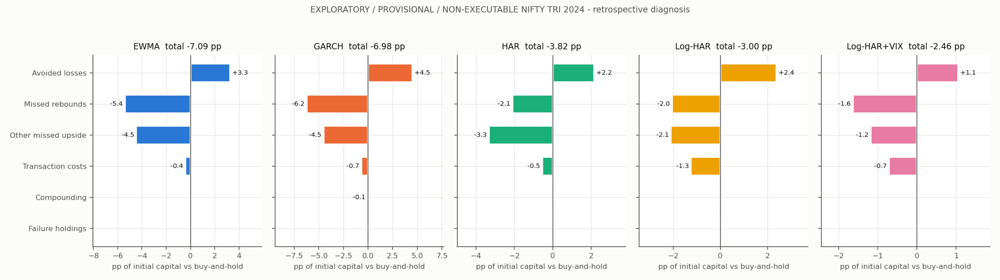
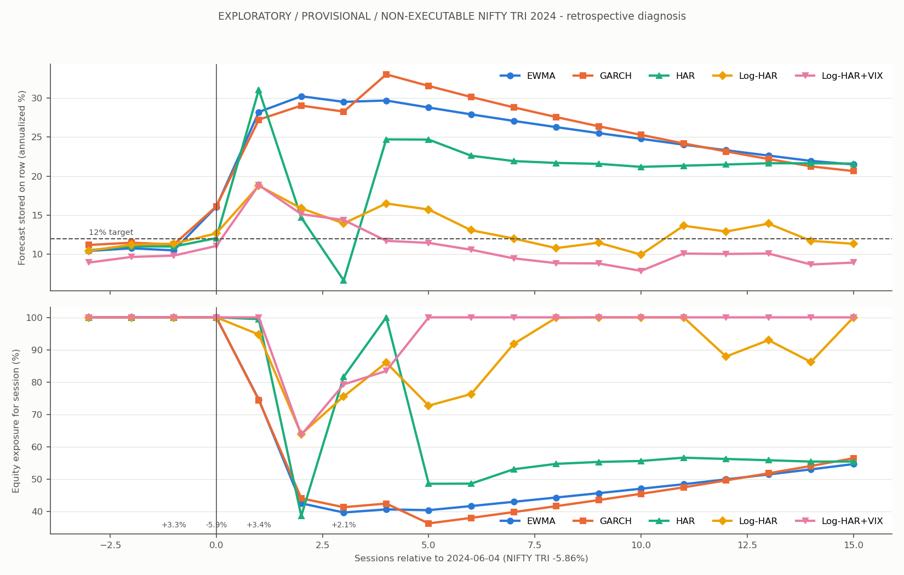
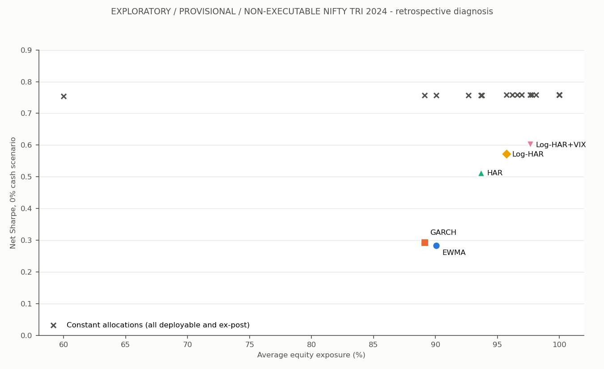

# Stage 6: economic failure analysis — EXPLORATORY / RETROSPECTIVE / NON-EXECUTABLE

This is a forensic reading of the saved Stage 5 run `dc64d101044366e3c892ea30`. It explains why the five primary 12%-target, daily, 10 bps, no-band volatility-targeting overlays on the theoretical NIFTY 50 TRI underperformed buy-and-hold in 2024. No new allocation rule was simulated, no model was refitted, no trade was executed and no observation after 2024-12-31 was read. All 742 Stage 5 output files were hash-verified against their manifest before analysis and 2,566 pre-existing report and Stage 5 files were verified unchanged after it. Diagnostic tables, figures and a manifest are in `experiments/stage6/runs/<run_id>/` (pointer: `reports/latest_stage6.json`).

2024 was inspected repeatedly during research. Everything below is **descriptive accounting of one already-seen year**. Labels such as "avoided loss" and "missed rebound" classify saved decisions after the fact; they do not show that any rule anticipated or could have anticipated an outcome. Causal statements are reserved for `stage6_research_inferences.md`, where they are stated as hypotheses.

## 1. Terminal-wealth decomposition

Each row splits dynamic-minus-buy-and-hold terminal wealth (percentage points of initial capital) into exclusive mechanisms. Allocation effects are (dynamic beginning equity fraction − buy-and-hold fraction) × dynamic beginning wealth × that session's equity return; categories partition every session. Rebound sessions are the positive-return sessions 1–10 after a sub −2% session (four such shocks in 2024: 17 Jan, 4 Jun, 5 Aug, 3 Oct). Components sum to the terminal difference with maximum error 2.5e-15, and every total matches the saved Stage 5 `pnl_attribution.csv` exactly.

| model | avoided losses | missed rebound | other missed upside | transaction costs | compounding | failure holdings | cash P&L | **terminal difference** |
| --- | --- | --- | --- | --- | --- | --- | --- | --- |
| EWMA | +3.28 | −5.42 | −4.48 | −0.43 | −0.04 | 0.00 | 0.00 | **−7.09** |
| GARCH | +4.49 | −6.21 | −4.52 | −0.67 | −0.07 | 0.00 | 0.00 | **−6.98** |
| HAR | +2.17 | −2.10 | −3.33 | −0.55 | −0.01 | 0.00 | 0.00 | **−3.82** |
| Log-HAR | +2.38 | −2.04 | −2.10 | −1.25 | +0.02 | 0.00 | 0.00 | **−3.00** |
| Log-HAR+VIX | +1.06 | −1.64 | −1.18 | −0.71 | +0.01 | 0.00 | 0.00 | **−2.46** |

"Avoided losses" combines loss sessions not preceded by a loss (+2.07, +2.49, +0.96, +0.88, +0.85) and loss sessions after a loss (+1.21, +2.00, +1.21, +1.50, +0.21). "Costs" are the dynamic path's costs minus buy-and-hold's single 0.10 pp entry cost. Cash P&L is zero because the primary cash scenario is 0%.



**Reading.** For every model, missed upside exceeded avoided losses by a factor of 1.7–3.0. Lower exposure on rising days, inside and outside post-shock windows, is the dominant drag. Transaction costs are secondary: 6–14% of the shortfall for EWMA, GARCH and HAR, and 29–42% for the two log models, whose forecasts oscillate around the 12% boundary (see §3).

### Persistent cash exposure

| model | mean cash | sessions with any cash | sessions >10% cash | sessions >50% cash | longest below-cap spell | arithmetic cash drag vs 100% equity |
| --- | --- | --- | --- | --- | --- | --- |
| EWMA | 9.9% | 137 | 84 | 11 | 62 | 6.38 pp |
| GARCH | 10.9% | 151 | 91 | 11 | 30 | 6.06 pp |
| HAR | 6.3% | 145 | 28 | 3 | 139 | 3.08 pp |
| Log-HAR | 4.3% | 93 | 46 | 0 | 15 | 1.69 pp |
| Log-HAR+VIX | 2.3% | 54 | 24 | 0 | 6 | 1.65 pp |

The arithmetic cash drag is a separate opportunity-cost diagnostic (Σ cash fraction × equity return). It is not added again to the reconciled decomposition. HAR's 139-session spell is mostly mild: it held 90–100% for most of H2 because its forecasts sat persistently just above 12% (§2).

### Concentration in one episode

| model | share of full-year allocation effect within 60 sessions after 4 Jun | mean exposure in that window | allocation effect outside that window |
| --- | --- | --- | --- |
| EWMA | 94% | 70.6% | −0.41 pp |
| GARCH | 97% | 74.9% | −0.20 pp |
| HAR | 111% | 80.9% | +0.35 pp |
| Log-HAR | 119% | 93.1% | +0.34 pp |
| Log-HAR+VIX | 62% | 95.5% | −0.67 pp |

The index rose 15.8% in the 60 sessions after the 4 June 2024 election-result session (−5.86%). Outside that window, allocation effects net to between −0.67 and +0.35 pp. **The 2024 failure is essentially one episode**, which limits every inference that follows.

### Forecast availability failures

The three HAR specifications had 22 missing-predictor sessions (24 April–24 May 2024, "Common HAR origin predictors unavailable; no imputation"). Under the registered hold-units rule all three were already at 100% exposure, so the failure contributed exactly 0.00 pp relative to buy-and-hold. The registered failure-to-cash stress shows the sensitivity of this rule. It reduced terminal return by 2.9–3.0 pp in all three cases, because the index rose 2.9% during the gap. Availability failures were economically harmless in the primary path only because of the hold rule and the starting exposure.

### Execution delay

The registered one-extra-session-delay stress paths (genuine horizon-3 forecasts) ended above their primary paths for all five models.

| model | primary terminal | delayed terminal | difference | rebound participation, primary → delayed |
| --- | --- | --- | --- | --- |
| EWMA | 2.84% | 4.25% | +1.41 pp | 0.72 → 0.80 |
| GARCH | 2.94% | 4.27% | +1.32 pp | 0.67 → 0.77 |
| HAR | 6.11% | 6.73% | +0.62 pp | 0.89 → 0.97 |
| Log-HAR | 6.93% | 8.00% | +1.07 pp | 0.90 → 0.96 |
| Log-HAR+VIX | 7.46% | 8.02% | +0.56 pp | 0.92 → 0.90 |

Slower reaction helped because 2024 returns reversed after large moves: lag-1 autocorrelation was −0.17, and the mean 3-session return after a shock was +1.46% against an unconditional +0.14%. This is a symptom of the failure mechanism, not an argument for delay. Delayed paths still underperformed buy-and-hold.

### Forecast bias

The ratio below is realized mean squared next-session log return divided by mean forecast variance, over the forecasts that drove each ledger. A ratio above one means forecasts were too low.

| model | 2024Q1 | 2024Q2 | 2024Q3 | 2024Q4 | full year | share of forecasts above 12% |
| --- | --- | --- | --- | --- | --- | --- |
| EWMA | 1.01 | 1.28 | **0.67** | 1.02 | 1.01 | 55% |
| GARCH | 0.87 | 1.20 | **0.74** | 0.91 | 0.96 | 61% |
| HAR | 1.24 | 1.70 | 0.73 | 1.08 | 1.17 | 64% |
| Log-HAR | 1.14 | 3.15 | 0.89 | 1.06 | 1.39 | 41% |
| Log-HAR+VIX | 1.15 | 3.94 | 0.97 | 1.32 | 1.58 | 24% |

HAR 2024Q2 covers 39 sessions because of the availability gap. EWMA and GARCH were unbiased on average but strongly over-forecast in Q3, the post-shock calm. Elevated forecasts persisted while realized risk had already normalized; that persistence is the rebound drag. The log models were biased low, which kept them near full exposure.

## 2. Forecast-to-decision timing

**Timing convention.** A forecast issued after close *t* executes at close *t+1* and first governs the return ending *t+2*. On a shock session the portfolio therefore holds the exposure chosen from information two sessions old. The first exposure reflecting the shock applies two sessions later.

| model | shock | exposure on shock day | first reactive exposure | sessions forecast stays >12% | sessions <95% exposure in next 60 | missed rebound, next 10 sessions |
| --- | --- | --- | --- | --- | --- | --- |
| EWMA | 4 Jun | 100% | 42.5% | 61 | 59 | −3.45 pp |
| GARCH | 4 Jun | 100% | 44.1% | 29 | 44 | −3.44 pp |
| HAR | 4 Jun | 100% | 38.7% | 2 | 36 | −1.65 pp |
| Log-HAR | 4 Jun | 100% | 63.9% | 7 | 23 | −1.14 pp |
| Log-HAR+VIX | 4 Jun | 100% | 63.7% | 3 | 16 | −0.78 pp |
| EWMA | 5 Aug | 94.6% | 72.8% | 19 | 26 | −1.25 pp |
| GARCH | 5 Aug | 100% | 68.7% | 17 | 33 | −1.37 pp |
| EWMA | 17 Jan | 100% | 91.5% | 22 | 18 | −0.50 pp |
| EWMA | 3 Oct | 99.5% | 85.3% | 11 | 32 | −0.22 pp |

The full 20-row table is `reports/stage6_shock_event_study.csv`. Across all 20 model-shock pairs, exposure was at or above 91% on the shock session.



**Was exposure reduced before or after losses?** After. On 3 June the index rose 3.25% on exit polls. That move raised EWMA and GARCH forecasts to about 16%, and those forecasts cut exposure to about 75% for 5 June. The 4 June loss was taken at full exposure by every model. Deep cuts to 39–44% (EWMA, GARCH, HAR) took effect on 6 June, after the 3.36% rebound of 5 June. They stayed in place through a further rally of 15.8% over 60 sessions. EWMA's forecast remained above 12% for 61 consecutive sessions, GARCH's for 29.

**How much recovery was missed?** In the four 10-session post-shock windows, missed rebound totalled 5.42 pp (EWMA), 6.21 (GARCH), 2.10 (HAR), 2.04 (Log-HAR) and 1.64 (Log-HAR+VIX). Of this, 64%, 55%, 79%, 56% and 48% respectively came after 4 June.

**Timing correlation.** Exposure was negatively correlated with same-session return for all five models (−0.07 to −0.17). Mean exposure was lower on up days than on down days for four models; for Log-HAR the two were equal to within 0.1 pp.

**The slow Q4 decline was not addressed.** From 27 September to 21 November the index fell 10.8% with quarterly volatility of only 12.9%. Mean Q4 exposure was 89–98%, and Q4 allocation effects were between −0.02 and +1.02 pp. Volatility targeting reacts to variance, not to direction. A low-volatility drawdown is outside its mechanism.

## 3. The 100% cap and why realized volatility exceeded 12%

| model | cap binding | portfolio vol | asset RMS vol on capped days | portfolio RMS vol on uncapped days | variance share from capped days | portfolio vol excluding 4 Jun |
| --- | --- | --- | --- | --- | --- | --- |
| EWMA | 44.8% | 13.10% | 15.37% | 10.82% | 62% | 11.68% |
| GARCH | 39.1% | 12.94% | 16.02% | 10.43% | 60% | 11.51% |
| HAR | 41.5% | 13.54% | 15.25% | 12.14% | 53% | 12.19% |
| Log-HAR | 62.5% | 13.49% | 14.05% | 12.47% | 68% | 12.13% |
| Log-HAR+VIX | 78.2% | 13.70% | 14.37% | 10.93% | 86% | 12.36% |

Buy-and-hold volatility was 13.97%, or 12.65% excluding 4 June. Three mechanisms explain the overshoot.

1. **Structural cap asymmetry.** When forecasts are below 12% the policy cannot lever up, so it inherits whatever realized risk occurs at 100%. When forecasts are above 12% it de-risks. The 12% figure is therefore an upper sizing guide, not a reachable average.
2. **Under-forecasting in calm states.** On capped days, forecasts were at or below 12% by construction, yet the asset realized 14.0–16.0%. Capped sessions supplied 53–86% of portfolio variance.
3. **The reaction lag on a jump day.** The 4 June session alone was 18% of the year's asset squared-return mass, and 19–21% of each dynamic portfolio's. It was taken at full exposure because the information arrived after the decision. Excluding that one session, every dynamic portfolio realized 11.5–12.4%.

Uncapped sessions undershot or roughly met the target (10.4–12.5%). Where the forecast was allowed to act, it sized as designed.

## 4. Forecast quality versus allocation value

| model | complexity order | QLIKE rank (1 = best) | calibration | mean exposure | net Sharpe | gross Sharpe | timing Sharpe vs same-exposure constant (net) | (gross) | turnover |
| --- | --- | --- | --- | --- | --- | --- | --- | --- | --- |
| EWMA | 1 | 4 | 1.01 | 90.1% | 0.283 | 0.322 | −0.475 | −0.435 | 5.1× |
| GARCH | 2 | 2 | 0.96 | 89.1% | 0.293 | 0.351 | −0.465 | −0.407 | 7.5× |
| HAR | 3 | 3 | 1.17 | 93.7% | 0.513 | 0.558 | −0.245 | −0.200 | 6.2× |
| Log-HAR | 4 | 1 | 1.39 | 95.7% | 0.572 | 0.665 | −0.186 | −0.093 | 12.6× |
| Log-HAR+VIX | 5 | 5 | 1.58 | 97.7% | 0.602 | 0.658 | −0.156 | −0.101 | 7.6× |

"Timing Sharpe" is the dynamic Sharpe minus the Sharpe of the ex-post constant with the same average exposure. That comparison is non-deployable and diagnostic only. Gross versions use the saved zero-cost shadows.

- **Forecast accuracy did not translate into allocation timing.** Across the five models, the Spearman correlation between QLIKE and net Sharpe was 0.10, and between QLIKE and timing Sharpe also 0.10. The best-QLIKE model ranked fourth on net Sharpe, and the worst-QLIKE model ranked first.
- **Mean exposure explains the ranking.** The Spearman correlation between mean exposure and net Sharpe was 0.90. Models that stayed closer to fully invested lost less.
- **Complexity was not economically useful as timing.** Every model's timing contribution was negative before and after costs. More complex models were less harmful mainly because their forecasts were biased low and decayed fast after shocks, so they behaved more like buy-and-hold. Log-HAR's 12.6× turnover came from oscillation across the cap boundary: 29 separate below-cap spells averaging 3.2 sessions.
- With n = 5 models in one year, these rank correlations are descriptive. They are not tests.



## 5. Benchmark fairness

**A. Development-matched constants (deployable).** These were fixed using only 2023-10-02 to 2023-12-29, a calm 60-session window in which every dynamic policy sat at or near the cap. They are therefore 96.2–100% equity, practically buy-and-hold. They did **not** remain matched in 2024: dynamic exposure averaged 89.1–97.7% and realized volatility 12.9–13.7%, against 96.2–100% and 13.4–14.0% for the constants. Each is a legitimate deployable comparison. It is a weak test of risk-equivalence, because a short calm calibration window cannot anticipate a policy's 2024 behaviour.

**B. Ex-post matched constants (non-deployable).** Matching full-2024 exposure (89.1–97.7%) or realized volatility (12.4–13.7%) uses evaluation outcomes. These constants earned net Sharpe 0.757–0.758, 0.16–0.47 above the dynamic paths. They are excluded from formal inference and answer only one question. Could similar de-risking have been achieved without timing? Yes, with the same or lower realized volatility and better Sharpe.

**Why both comparisons agree.** With a 0% cash return and daily rebalancing, a constant allocation's Sharpe is nearly invariant to its weight; costs are the only difference. All 22 saved constant paths, deployable or not, lie between 0.754 and 0.759. The Sharpe shortfall is therefore insensitive to which constant is chosen, while return and volatility comparisons are not. The invariance breaks under the 4% cash scenario, where Sharpe measures excess return.

**Uncertainty.** The saved Stage 5 paired stationary bootstrap (2,000 draws, block 10, Holm across 15 contrasts) flags 3 of 15 contrasts, all Log-HAR+VIX underperformance. The other point estimates are negative, with Holm-adjusted p between 0.11 and 0.19. The bootstrap is conditional on saved signals and ignores research-selection and parameter uncertainty.

## 6. What is and is not established

| statement | status |
| --- | --- |
| Missed upside exceeded avoided losses for all five models in 2024 | Accounting fact, reconciled to terminal wealth |
| One episode (4 Jun and the following 60 sessions) explains 62–119% of the allocation shortfall | Accounting fact |
| De-risking took effect after the main loss, by construction of the two-session lag | Structural fact of the registered timing |
| Persistence of post-shock forecasts caused the rebound drag | Plausible mechanism; one dominant event, not causally identified |
| Better forecasts do not produce better allocation | Not established. Absence of association across five models in one year |
| Volatility targeting does not work on NIFTY | **Not established.** One year, one asset, one dominant event, theoretical index |
| A different rule would have worked better | Not examined. Stage 6 does not select rules |

Reproduce:

```powershell
$env:PYTEST_DISABLE_PLUGIN_AUTOLOAD = '1'
.\.venv\Scripts\python.exe -m pytest -q tests/test_stage6_diagnosis.py --junitxml=reports/pytest-stage6.xml
$env:PYTHONPATH = 'src'; .\.venv\Scripts\python.exe -m volrisk.stage6_cli run
```
